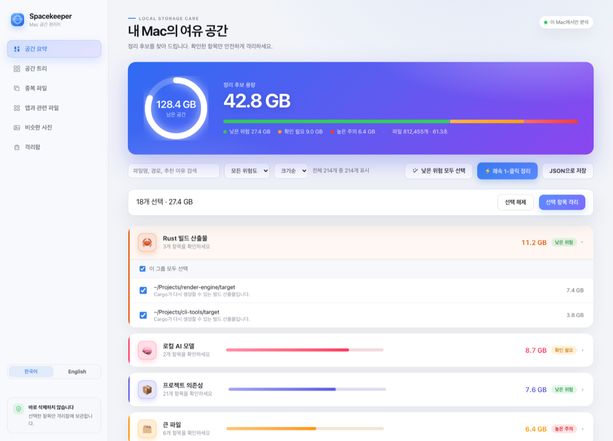

# Spacekeeper

A macOS storage cleaner that **never deletes anything**.

Most cleaners ask you to trust a number and press a big button. Spacekeeper does
the opposite: it explains why every item is a candidate, moves only what you
picked into a quarantine folder, and lets you put it all back.

[한국어 문서](README.ko.md)



---

## Why another cleaner

**Nothing is destroyed.** "Cleaning" moves files to `~/.spacekeeper/quarantine/`
and records where they came from. Restore is one click. Emptying goes to the
macOS Trash, so even that step is reversible.


*The app says this on first launch, before it scans anything.*

**Every item explains itself.** Each candidate carries a reason ("Cargo can
rebuild this"), a caution, and a risk level. No opaque "Junk: 12.4 GB" buckets.

**Honest numbers.** Sizes are measured from allocated blocks (`st_blocks`), not
logical size, so sparse files and cloud placeholders don't inflate the total. The
UI says up front that APFS clones may make the real gain smaller. When a scan
stops at a limit, it says so instead of implying it saw everything.

**It knows what developers actually accumulate.** `node_modules`, Rust `target`,
Xcode `DerivedData`, `.next`, package manager caches, local LLM weights. On the
author's Mac these were ~23 GB that consumer cleaners never touch.

**Local only.** No account, no telemetry, no network calls. Python standard
library only — no third-party runtime dependencies.

## What it finds

| | |
|---|---|
| **Overview** | Large files, old downloads, regenerable caches, build artifacts — grouped by category with a size bar per group |
| **Space tree** | Treemap of what is actually using the disk |
| **Duplicates** | Byte-identical files (SHA-256), one copy kept per group |
| **Similar photos** | Perceptual hash (dHash) finds the same photo at different sizes or compression |
| **Apps & leftovers** | Installed apps plus the support/cache/preference files they leave in `~/Library` |
| **Browser & mail caches** | Safari, Chrome, Firefox, Edge, Arc, Mail — caches only, never mail stores or site data |
| **Startup items** | Login items; disabling moves the plist to quarantine so it is reversible |
| **Quarantine** | Everything you moved, with restore and "empty to Trash" |
| **Diagnostics** | Whether protected folders are readable and quarantine/restore actually work |

## Requirements

- macOS 12 or later (Apple Silicon)
- Python 3.11+ (for running from source)

## Run from source

```bash
git clone <this-repo>
cd spacekeeper
python3 -m spacekeeper --serve      # http://127.0.0.1:8765
```

There is also a CLI that prints a read-only report:

```bash
python3 -m spacekeeper ~/Downloads
python3 -m spacekeeper ~ --duplicates
python3 -m spacekeeper ~ --plan --risk low
```

## Build the desktop app

The desktop app is Tauri v2 with the Python server bundled as a self-contained
sidecar, so the shipped `.app` needs no Python installed.

```bash
cd desktop
npm install
npm run build        # -> src-tauri/target/release/bundle/{macos,dmg}
```

The app lives in the menu bar; closing the window keeps it running, and "Quit"
from the tray stops the bundled server too.

> **Unsigned builds.** Releases are ad-hoc signed, not notarized with an Apple
> Developer ID. macOS will warn on first launch — right-click the app and choose
> **Open**, or build it yourself with the commands above.

## Full Disk Access

Desktop, Documents and Downloads are protected by macOS. To analyze them, add
Spacekeeper under **System Settings → Privacy & Security → Full Disk Access**.
Without it those folders are skipped and reported as permission-limited; the
rest still works.

## Safety model

1. No deletion. Selected items are moved to quarantine and logged in a manifest.
2. Restore returns an item to its exact original path.
3. Emptying quarantine moves to the macOS Trash, not `unlink`.
4. Moves are restricted to your home folder and `/Applications`. `/System`,
   `/Library`, `~/.ssh` and Keychains are refused outright.
5. Symlinks are never followed.
6. Background scheduled runs notify only. Auto-quarantine is off by default and
   must be enabled explicitly.

## Development

```bash
python3 -m unittest discover -s tests
```

Contributions welcome. If you add a filesystem walker, it must skip cloud
containers (`~/Library/CloudStorage`, `~/Library/Mobile Documents`) and catch
`OSError` *during* iteration — offline placeholders otherwise stall for ~17
seconds per folder and then raise.

## License

MIT — see [LICENSE](LICENSE).
